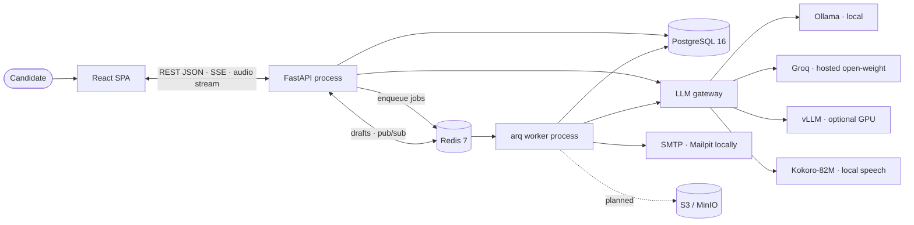
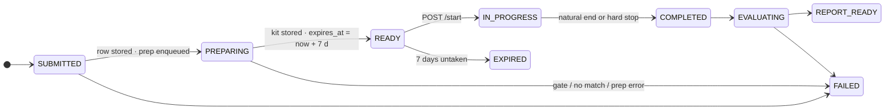
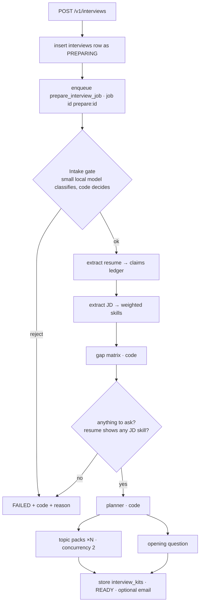
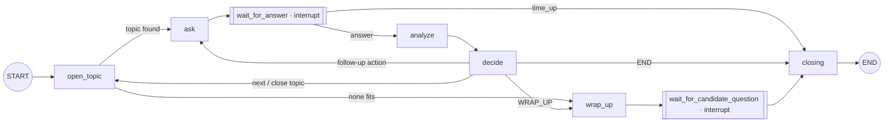
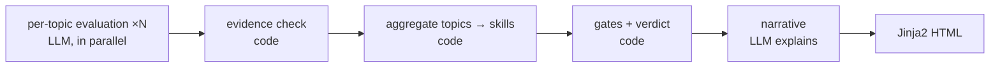
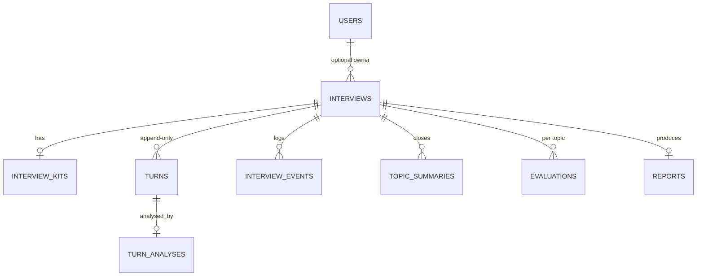

# QualifAI — Architecture

The architect's reference for QualifAI: what runs where, how the three phases work, every
technology and protocol, the full database schema, and what is built versus still open.

It describes the code as it is. Where older docs and the code disagree, this file follows the code.
Short pitch: [README](README.md) · narrative tour: [deep dive](docs/deep-dive.md) ·
decisions: [ADRs](docs/architecture/adr/README.md).

## Contents
1. [System in one page](#1-system-in-one-page)
2. [Architectural principles](#2-architectural-principles)
3. [Runtime topology](#3-runtime-topology)
4. [Technology stack](#4-technology-stack)
5. [Code structure and layering](#5-code-structure-and-layering)
6. [Interview lifecycle](#6-interview-lifecycle)
7. [Phase 1 — Prep](#7-phase-1--prep)
8. [Phase 2 — Live interview](#8-phase-2--live-interview)
9. [Phase 3 — Evaluation](#9-phase-3--evaluation)
10. [LLM layer](#10-llm-layer)
11. [Data architecture](#11-data-architecture)
12. [Protocols and interfaces](#12-protocols-and-interfaces)
13. [HTTP API reference](#13-http-api-reference)
14. [Frontend](#14-frontend)
15. [Content as configuration](#15-content-as-configuration)
16. [Concurrency, consistency and failure handling](#16-concurrency-consistency-and-failure-handling)
17. [Security and privacy](#17-security-and-privacy)
18. [Configuration and deployment](#18-configuration-and-deployment)
19. [Quality gates and testing](#19-quality-gates-and-testing)
20. [Implementation status and known gaps](#20-implementation-status-and-known-gaps)
21. [Decision index](#21-decision-index)

---

## 1. System in one page

QualifAI runs a timed, adaptive mock technical interview from a pasted resume and job description,
then scores it with evidence. **The software runs the interview; the LLM is a component inside it.**

| Phase | Trigger | What it produces | Where it runs |
|---|---|---|---|
| 1. Prep | `POST /v1/interviews` | Interview kit: claims, JD skills, gap matrix, time-budgeted plan, topic packs, opening question | arq worker, large model, minutes |
| 2. Live interview | `POST /v1/interviews/{id}/start` | Append-only transcript, per-turn signals, integrity events | API process, LangGraph loop, fast models, seconds per turn |
| 3. Evaluation | Interview ends | Per-topic scores with quotes, computed verdict, narrative, HTML report | arq worker, large model, minutes |



It is a **stateful workflow with deterministic control**, not a RAG application. Resume and JD fit
in context; retrieval is reserved for a V2 real-question corpus (ADR-0011).

---

## 2. Architectural principles

| # | Principle | How it is enforced |
|---|---|---|
| 1 | **LLM proposes, policy disposes.** Routing, time, difficulty, coverage, aggregation and the verdict are plain Python. LLMs extract, classify, phrase and score with evidence. | Graph edges read a `PolicyDecision`; no LLM output selects an edge (ADR-0002) |
| 2 | **The deterministic core is pure.** `interview/policy.py`, `time_window.py`, `coverage.py`, `eval/aggregation.py`, `verdict.py`, `evidence_check.py` import no LLM, DB, LangGraph, OpenAI or SQLAlchemy code. | import-linter contract, architecture tests, a PostToolUse hook |
| 3 | **Only `qualifai.llm` talks to model providers.** Models are chosen in `content/models.yaml`. | import-linter contract forbids `openai` in `prep`, `interview`, `eval`, `api` |
| 4 | **Bounded context.** No live call receives the whole transcript. | `interview/context_compiler.py`, 2,000-token budget for the Turn Analyzer |
| 5 | **Evidence or no score.** Each score cites a quote that code finds in the transcript. | `eval/evidence_check.py` drops unsupported dimensions |
| 6 | **Content is config.** Rounds, tiers, role families, skills, problems, model routes and the interviewer persona are YAML. | Typed loaders in `content/loader.py` (`extra="forbid"`) |
| 7 | **`turns` is append-only**, and an answer is committed before the next question exists. | Unique `(interview_id, seq)`, `ON CONFLICT DO NOTHING`, own short transaction per write |
| 8 | **Candidate text is data, never instructions.** | Tagged in every prompt; injection markers flagged, not obeyed |

Style: Python 3.12, mypy strict, Pydantic v2 models frozen with `extra="forbid"`, small pure
functions for logic, async for I/O, time and LLM always injected (`Clock`, `LLM` protocols).

---

## 3. Runtime topology

A **modular monolith: one codebase, two processes** (ADR-0001). Both are built from the same
composition root, `src/qualifai/container.py`.

| Process | Command | Responsibilities |
|---|---|---|
| API | `uvicorn qualifai.api.main:app` | REST, SSE, audio streaming, serving the built SPA, **running the live interview graph in-process** |
| Worker | `arq qualifai.workers.worker.WorkerSettings` | `prepare_interview_job`, `evaluate_interview_job`, `hard_stop_job`, daily `expire_kits` cron (03:17). `max_jobs = 4`, `job_timeout = 20 min` |

Both processes open a `LiveRuntime` at startup: the `InterviewService` (compiled graphs plus the
Postgres checkpointer), the LLM gateway, the arq Redis pool and the SQLAlchemy session factory.
The worker needs it because the hard-stop job resumes the same graph the API runs.

| Backing service | Image (local) | Port | Role |
|---|---|---|---|
| PostgreSQL 16 | `pgvector/pgvector:pg16` | 5432 | Source of truth, LangGraph checkpoints, pgvector reserved for V2 |
| Redis 7 | `redis:7-alpine` | 6379 | arq queue and delayed jobs, answer drafts, live pub/sub |
| MinIO | `cgr.dev/chainguard/minio` | 9000 / 9001 | S3-compatible object storage for rendered reports (not yet written to) |
| Mailpit | `axllent/mailpit` | 1025 / 8025 | Catches SMTP mail locally |
| Ollama | `ollama/ollama` (profile `llm`) | 11434 | Local open-weight chat models |
| Kokoro | `ghcr.io/remsky/kokoro-fastapi-cpu` (profile `voice`) | 8880 | Local speech model, OpenAI-compatible `/v1/audio/speech` |
| Judge0 | commented out (profile `coding`) | — | V2 code sandbox |

---

## 4. Technology stack

### Backend
| Concern | Choice | Notes |
|---|---|---|
| Language | Python ≥ 3.12 | mypy strict with the Pydantic plugin |
| Web framework | FastAPI + Uvicorn | Thin routes: validate → application service → map result |
| Validation / contracts | Pydantic v2, pydantic-settings | Domain models double as LLM output schemas |
| Live loop | LangGraph + `langgraph-checkpoint-postgres` | Used only for the cyclic, interruptible live loop (ADR-0003) |
| ORM / driver | SQLAlchemy 2.0 async + asyncpg | psycopg 3 pool used separately by the checkpointer |
| Migrations | Alembic | Head: `c93b1f6a0d52` |
| Jobs | arq on Redis | Delayed jobs and cron built in; no extra broker |
| LLM client | `openai` SDK as a generic OpenAI-compatible client | Never pointed at OpenAI; tenacity for output retries |
| Streaming | `sse-starlette`, `StreamingResponse` | SSE for tokens, chunked audio for speech |
| Reports | Jinja2 with autoescape | HTML is rendered by template, never written by a model |
| Object storage | boto3 against an S3 endpoint | |
| Email | aiosmtplib | |
| IDs | `uuid6` (UUIDv7, time-ordered) | |
| Logging | structlog | Structured events: `llm.call`, `llm.speech`, `prep.progress`, `room.hard_stop` |
| Packaging | uv, hatchling | |

### Frontend
React 19 · TypeScript 6 · Vite 8 · Tailwind CSS 4 · react-router-dom 7 · oxlint · Geist fonts.
Browser APIs: `fetch`, `EventSource`, `HTMLAudioElement`, Web Speech (`SpeechSynthesis`,
`SpeechRecognition`). No state library, no AI in the browser.

### Models (all open-weight, all behind one gateway)
gpt-oss-120b and gpt-oss-20b (Groq), Qwen 3.x 27B (Groq), Gemma 4 small and Qwen2.5-Coder
(Ollama), Kokoro-82M (local speech). Full routing table in [section 10](#10-llm-layer).

### Tooling
ruff (lint + format) · mypy · import-linter · pytest, pytest-asyncio, pytest-cov · Hypothesis ·
testcontainers (Postgres, Redis) · Locust · pre-commit · GitHub Actions · Docker Compose.

### Deliberately not used
MCP (ADR-0010), microservices and message brokers such as Kafka (ADR-0001), MongoDB, a separate
vector database (ADR-0011), server-side speech recognition (ADR-0022).

---

## 5. Code structure and layering

```
src/qualifai/
  domain/         enums, Pydantic models, lifecycle state machine, clock, errors, tokens (no I/O)
  content/        typed YAML loaders
  llm/            gateway, router, task enum, speech helpers, prompts/*.md, FakeLLM
  db/             SQLAlchemy models, session, repositories/turns.py (the transcript sink)
  storage/        live.py (Redis drafts + pub/sub), objects.py (S3)
  prep/           submission, intake gate, extraction, taxonomy, gap matrix, match, planner,
                  topic packs, opening question, pipeline
  interview/      time_window, policy, coverage, topic_selector, context_compiler, turn_analyzer,
                  question_generator, state, graph, service, room, checkpoint
  eval/           topic_evaluator, evidence_check, aggregation, verdict, narrative,
                  report_renderer, templates/report.html.j2, pipeline
  coding/         V2 sandbox protocol and controller (stubs)
  notifications/  email
  workers/        worker settings, jobs/{prepare,evaluate,hard_stop,cleanup}
  api/            main (app factory, SPA mount), deps, errors, schemas, routes/
  config/         settings
  container.py    composition root for both processes
content/          rounds/ tiers/ role_families/ skills/ coding_problems/ models.yaml interviewer.yaml
frontend/         React SPA
migrations/       Alembic
tests/            unit · architecture · contract · integration · e2e · security · evals · load
```

**Layer contract** (import-linter `layers`, higher may import lower, never the reverse):

```
qualifai.api
qualifai.workers
qualifai.prep | qualifai.interview | qualifai.eval | qualifai.coding
qualifai.llm  | qualifai.db        | qualifai.content
qualifai.domain
```

Two application services sit between HTTP/jobs and the engines:

- `prep/submission.py` — behind `POST /v1/interviews`.
- `interview/room.py` — behind start, answers, draft, rejoin, audio and the hard-stop job. It owns
  the `interviews` row; `interview/service.py` owns the graph and knows nothing about HTTP or tables.

Side effects are behind protocols so engines stay testable: `LLM`, `Clock`, `TurnSink`
(transcript + streaming), `Drafts`, `Sandbox`.

---

## 6. Interview lifecycle

`domain/lifecycle.py` is the only place a status may change. Illegal moves raise
`InterviewStateError` (HTTP 409).



`FAILED`, `REPORT_READY` and `EXPIRED` are terminal. A failed interview is never retried; trying
again is a new submission (ADR-0018, ADR-0021). `SUBMITTED` is never persisted: the row is written
directly as `PREPARING`.

**Failure codes** (`interviews.failure_code`, with a candidate-readable `failure_reason`):
`not_a_resume`, `not_a_jd`, `resume_not_software`, `jd_not_software`, `undecided`,
`no_known_skills`, `resume_jd_no_match`, `prep_error`.

**End reasons** (`interviews.end_reason`): `natural`, `hard_stop` in use; `early_complete` and
`abandoned` are defined but not yet produced.

---

## 7. Phase 1 — Prep

Plain async code, no LangGraph: it is a DAG with no cycles and no human input.



| Step | Module | LLM? | Detail |
|---|---|---|---|
| Submission | `prep/submission.py` | no | Creates a `users` row only if an email was sent. UUIDv7 id, returned as the **meet id**. If the enqueue fails, the interview is marked FAILED and the error surfaces. |
| Intake gate | `prep/intake_gate.py` | `intake_gate` | Model returns `IntakeResult` (is-resume, is-JD, role family of each, confidence). Code decides: both documents must be a supported software family; confidence floor 0.6; unknown family → `undecided`. Sets `role_family` and `support_level` (`full` for backend SDE, `partial` for fullstack, frontend, data, devops, integration, QA, ML). Input is truncated to 4,000 / 3,000 characters. |
| Extraction | `prep/extraction.py` | `resume_extract`, `jd_extract` | Resume → `ResumeClaim` list (text, skills, ownership verb, metrics, evidence level) plus years of experience. JD → `JDSkill` list (weight 1–3, must-have). Skills are normalised through the taxonomy dictionary; a child skill also credits its parent (FastAPI shows Python). JD skills outside the taxonomy are kept aside for the match check only. |
| Gap matrix | `prep/gap_matrix.py` | no | Per JD skill: strong claim + high weight → `VERIFY_CLAIM`; weak or no evidence + high weight → `TEST_GAP`; low weight → `LIGHT`. Priority = weight × probe factor (1.2 / 1.0 / 0.8 / 0.4) × 1.5 if must-have. Every verified claim also gets a `FUNDAMENTALS` row so the interview is not only project talk (ADR-0023). |
| Round skills | `prep/pipeline.py` | no | A focused round (DSA, LLD, HLD, managerial) plans its own `skills` from the round template instead of the JD's (ADR-0019). R1 adds its `always` skills (one problem-solving topic). |
| Match check | `prep/match.py` | no | A JD skill counts as shown if a claim carries it **or** the resume text names it or an alias as a whole word. Prep stops only when **nothing** overlaps, with a reason naming up to five missing skills (ADR-0018). |
| Planner | `prep/planner.py` | no | Phase budgets from the round's weights (drift added to the largest phase). Top 10 rows → 4 must, 3 should, 3 bonus. Must and should share the core budget in proportion to priority (minimum 180 s); bonus topics get 180 s. `max_depth` from the tier; start difficulty = 2 + tier offset + 1 if max experience ≥ 6 years, clamped 1–4. |
| Topic packs | `prep/topic_packs.py` | `topic_pack` | One call per topic: opening questions, rubric (expected points, red flags, follow-up hooks), grounded in the skill's seed bank. No seed bank → generated "unanchored". Two at a time, because hosted free tiers cap tokens per minute. |
| Opening question | `prep/opening.py` | `opening_question` | Written once from the lead claims and must-cover skills, so the interview starts without a model call. Runs in parallel with the packs. |
| Persist | `workers/jobs/prepare.py` | no | `session.merge` of the kit (a redelivered job overwrites its own), `READY`, `ready_at`, `expires_at`. If there is a user: a 32-byte URL-safe token is generated, only its SHA-256 hash stored, and a magic link emailed. |

**Progress reporting.** Each step is committed as an `interview_events` row of type `prep_step`
when it starts. The status endpoint returns the ordered, de-duplicated list and the page polls it.
Pushing progress over pub/sub to SSE is open (T-15).

**Idempotency.** The job exits immediately unless the interview is still `PREPARING`. Any unexpected
exception marks the interview `FAILED` with `prep_error` and re-raises for the job log.

---

## 8. Phase 2 — Live interview

### 8.1 Starting

`room.start_interview`: lock the row → check the owner token if the interview was emailed → require
`READY` and not expired (one attempt per kit) → build the `TimeWindow` → run the graph to its first
interrupt → store the window on the row → schedule the hard stop at `hard_end + 60 s` → commit.

The first thing said is fixed text from `content/interviewer.yaml` (the interviewer introduces
himself and asks for an introduction) followed by the kit's opening question. No model call.

### 8.2 The graph

One LangGraph `StateGraph`, one checkpoint thread per interview (`thread_id == interview_id`).



| Node | LLM? | What it does |
|---|---|---|
| `open_topic` | no | `topic_selector.next_topic`: must → should → bonus, plan order within a priority, and the topic's minimum must fit the time left minus 120 s |
| `ask` | `question_gen` (stream) | Phrases the already-chosen action. Tokens are published as they arrive; the full text is committed as an interviewer turn. The very first question is the stored opening and uses no model. |
| `wait_for_answer` | no | `interrupt()`. Resumed with `{type: "answer"}` or `{type: "time_up"}`. Stamps `resumed_at` and computes answer seconds from the injected clock. |
| `analyze` | `turn_analyzer` | **Commits the candidate turn first**, then asks for `TurnSignals` over a bounded context, then stores the analysis with model name and latency. |
| `decide` | no | Calls `policy.decide`, updates topic progress (depth, scaffold used, difficulty, status). |
| `wrap_up` | `question_gen` | Thanks the candidate and invites one question about the role. |
| `wait_for_candidate_question` | no | Second interrupt. |
| `closing` | `question_gen` only if the candidate asked something | Writes any unsaved answer (the candidate's own question, or a draft cut off by time), answers the candidate from the first 2,000 characters of the JD, then says a **fixed** farewell. The end never depends on a model. |

State (`interview/state.py`) is a JSON-serialisable `TypedDict` checkpointed after every node:
plan, window, per-topic progress, current topic, turn sequence, last question/answer/signals, last
decision, timing stamps, accumulated system latency, end reason and `graph_version`. `BUILDERS`
keeps a graph builder per version so an interview finishes on the graph it started on.

### 8.3 Turn Analyzer signals

`TurnSignals` (structured output, never a decision): `intent` (answer, dont_know,
clarification_request, off_topic, redirect_attempt), rubric points covered and missing,
`coverage_ratio` 0–1, `specificity` (low, medium, high), `consistency` against the resume claim
(consistent, inflated, contradicts, unknown), up to three `hooks`, and a `proposed_follow_up` the
policy is free to ignore.

**Context compiler.** Slices carry a priority and a `static` flag. Static slices go first (prefix
caching), and the lowest-priority slices are dropped until the estimate (about 4 characters per
token) fits the 2,000-token budget. Priority 0 (round rules, topic, rubric) is never dropped.

### 8.4 Policy engine

`interview/policy.py`, a pure function `decide(PolicyInput) -> PolicyDecision`, evaluated in order:

| Order | Condition | Action |
|---|---|---|
| 1 | Zone is `EXPIRED` | `END` |
| 1 | Zone is `OVERTIME` | `WRAP_UP` (no new questions) |
| 2 | Intent is `redirect_attempt` | `REDIRECT_BACK` |
| 2 | Intent is `clarification_request` | `REPHRASE_QUESTION` |
| 3 | Follow-up allowed, and claim inflated or contradicted | `CHALLENGE_CLAIM` |
| 3 | Follow-up allowed, and "don't know" or coverage < 0.3 | `SCAFFOLD` once (difficulty −1), then move on |
| 3 | Follow-up allowed, and specificity low | `PROBE_SPECIFICITY` |
| 3 | Follow-up allowed, and coverage ≥ 0.7 | `FOLLOW_UP_DEEPER` (difficulty +1) |
| 3 | Follow-up allowed, otherwise | `CLARIFY_MISSING` |
| 4 | Topic budget used | `CLOSE_TOPIC_TIME` → next topic or `WRAP_UP` |
| 4 | Depth or spare time exhausted | `NEXT_TOPIC` or `WRAP_UP` |

A follow-up is allowed only when `depth < max_depth`, the topic is within budget, and
`free ≥ 150 s`, where the **coverage guard** is

```
free = remaining_to_hard_end − Σ(min seconds of unvisited must-cover topics) − 120 s closing reserve
```

Moving on wraps up instead when no topic is left, when the next topic does not fit, or (in the
closing zone) when it does not fully fit before `hard_end`. If the topic after this one would not
fit, the decision carries `announce_last_question`, and the generator is told only "this is the
final technical question". The model never sees the clock.

### 8.5 Time window

`interview/time_window.py` (ADR-0012). The server owns the clock.

| Target | soft_start | target_end | hard_end |
|---|---|---|---|
| 30 min | 27 | 30 | 33 |
| 45 min | 40 | 45 | 50 |
| 60 min | 55 | 60 | 65 |
| other | target − slack | target | target + slack, slack = max(3, 10%) |

Zones: `NORMAL` → `CLOSING` (from soft_start) → `OVERTIME` (from target_end) → `EXPIRED` (from
hard_end).

**Latency credit.** Time the candidate spent waiting on the system (answer received → next question
committed) accumulates in the graph state. Anything above 2 s, capped at 180 s, shifts the whole
window, so slow hardware does not cost the candidate interview time. The room stores the credit on
the row after every turn.

### 8.6 Hard stop

A delayed arq job, scheduled once at start with job id `hard_stop:{id}:{due_epoch}`. When it fires
it locks the row and: does nothing if the interview is already over; **re-schedules itself** if the
latency credit moved `hard_end`; otherwise loads the Redis draft for the pending question, resumes
the graph with `time_up`, and the draft is stored as a `cut_off` candidate turn. If a turn was in
flight and has just produced a question, it advances once more to close.

### 8.7 Ending

`room._settle`: latency credit stored, status → `COMPLETED`, `ended_at`, `end_reason`, commit,
draft cleared, `evaluate_interview_job` enqueued (job id `evaluate:{id}`; a failed enqueue is
logged and does not undo the end).

### 8.8 Voice

- **Speaking (ADR-0024).** `GET /turns/{seq}/audio` voices a stored interviewer turn through the
  `speech` task: Kokoro-82M, voice `am_michael`, MP3. Text is cut into pieces of at most 90
  characters at sentence ends and each piece is streamed as soon as it is synthesised, so the first
  sentence plays while the rest is made. The page names a turn; it never sends words to be spoken.
  503 `speech_unavailable` makes the page fall back to the browser's `SpeechSynthesis`.
- **Listening (ADR-0022).** Entirely in the browser (`SpeechRecognition`, `en-IN`). The server only
  ever receives text. Where the browser cannot listen, the room falls back to a text box.

---

## 9. Phase 3 — Evaluation

`eval/pipeline.py` is a fan-out / fan-in in plain async code:



| Step | Module | Rule |
|---|---|---|
| Topic evaluation | `topic_evaluator.py` | One call per topic thread (opening question plus follow-ups), not per question and not per interview. Returns `DimensionScore`s on an **anchored 1–4 scale**, each with `EvidenceQuote`s, plus points covered/missed and a claim verdict (verified, partial, contradicted, untested). |
| Evidence check | `evidence_check.py` | A quote must be found in the candidate's turns: exact after normalisation, else a sliding-window fuzzy match with ratio ≥ 0.85. The cited turn is preferred, any candidate turn of the topic is accepted. A dimension with no surviving quote is **dropped**. |
| Aggregation | `aggregation.py` | Level → /10 (1 → 2.5, 2 → 5.0, 3 → 7.5, 4 → 10). Topic score = mean of surviving dimensions. Skill score = mean of its topics weighted by questions asked. Confidence: ≥ 4 questions high, ≥ 2 medium, else low. **Not asked means not assessed, never zero.** |
| Verdict | `verdict.py` | `overall = Σ(skill × JD weight) / Σ(JD weight)` over assessed skills, then gates, then tier thresholds. |
| Narrative | `narrative.py` | Receives the computed JSON and returns summary, strengths, gaps, deciding gap and a prep plan. It cannot change a number. |
| Render | `report_renderer.py` | `templates/report.html.j2`, autoescaped. Report JSON is the source of truth; HTML is derived. |

**Gates** only lower or withhold a verdict:

| Gate | Rule | Effect |
|---|---|---|
| Coverage | Must-cover topics opened < 75% | `insufficient_evidence`, no overall score |
| No assessed skills | Nothing assessed matches the JD | `insufficient_evidence` |
| Must-have | A must-have skill below the tier floor (5.0; MAANG 5.5) | Capped at Lean Hire |
| Claim | Any contradicted resume claim | Capped at Lean Hire |
| Coding (V2) | Hidden tests passed < 50% | Capped at Hire |
| Integrity | Paste or timing flags | Warning only, verdict unchanged |

**Tier thresholds** (`content/tiers/*.yaml`):

| Band | Service | Startup | Product | MAANG |
|---|---|---|---|---|
| Strong Hire | ≥ 8.0 | ≥ 8.2 | ≥ 8.5 | ≥ 8.8 |
| Hire | ≥ 6.5 | ≥ 7.0 | ≥ 7.5 | ≥ 8.0 |
| Lean Hire | ≥ 5.5 | ≥ 6.0 | ≥ 6.5 | ≥ 7.0 |
| Lean No Hire | ≥ 4.5 | ≥ 5.0 | ≥ 5.5 | ≥ 6.0 |

Bands map to candidate-facing labels: Strong Hire and Hire → "Ready", Lean Hire → "Almost ready",
Lean No Hire and No Hire → "Needs preparation", insufficient evidence → "Incomplete interview".

> The pipeline and its deterministic parts are implemented and unit-tested. The job that feeds it
> from the database, stores the report and serves it is not wired yet. See
> [section 20](#20-implementation-status-and-known-gaps).

---

## 10. LLM layer

`qualifai.llm` is the only package that imports a provider SDK. Everything else depends on a
three-method protocol:

```python
class LLM(Protocol):
    async def structured(self, task, system, user, schema) -> T   # JSON validated by Pydantic
    def stream(self, task, system, user) -> AsyncIterator[str]    # live phrasing
    async def speak(self, task, text) -> Speech                   # text to audio
```

`LLMGateway` implements it over `AsyncOpenAI` clients, one per provider declared in
`content/models.yaml`. `FakeLLM` implements it with deterministic responders for tests.

**Structured output.** `response_format = {type: "json_schema", json_schema: <Pydantic schema>}`.
The reply is parsed with `schema.model_validate_json`. A validation error, an empty reply, or a
provider 400 with code `json_validate_failed` counts as bad output and is retried up to 3 times
with exponential backoff (0.5–4 s).

**Rate limits.** The SDK itself retries up to 8 times. On top of that, a `RateLimitError` is waited
out in 15 s pauses for as long as the route's `rate_limit_patience_s` allows: 300 s for prep
routes, 0 for live routes, which must fail fast.

**Routing table** (`content/models.yaml`, change models here, never in code):

| Phase | Task | Provider · model | Temp | Max tokens | Notes |
|---|---|---|---|---|---|
| Prep | `intake_gate` | Ollama · `gemma4:e2b-it-qat` | 0.0 | 300 | 120 s timeout (first call loads the model) |
| Prep | `resume_extract` | Groq · `openai/gpt-oss-120b` | 0.0 | 2500 | low reasoning effort, patience 300 s |
| Prep | `jd_extract` | Groq · `openai/gpt-oss-120b` | 0.0 | 1500 | same |
| Prep | `topic_pack` | Groq · `openai/gpt-oss-120b` | 0.3 | 1400 | same |
| Prep | `opening_question` | Groq · `openai/gpt-oss-120b` | 0.4 | 500 | same |
| Prep | `topic_selection` | Groq · `openai/gpt-oss-120b` | 0.2 | 1500 | routed, no caller yet |
| Live | `turn_analyzer` | Groq · `openai/gpt-oss-20b` | 0.0 | 900 | 15 s timeout |
| Live | `question_gen` | Ollama · `gemma4:e2b-it-qat` | 0.6 | 150 | streamed, reasoning off |
| Live | `speech` | Kokoro · `kokoro`, voice `am_michael` | — | — | MP3, 90-character pieces, 30 s timeout |
| Live | `coding_helper` | Groq · `openai/gpt-oss-20b` | 0.2 | 400 | V2 |
| Eval | `topic_eval` | Groq · `qwen/qwen3.8-27b` | 0.0 | 1200 | |
| Eval | `code_review` | Ollama · `qwen2.5-coder:14b` | 0.0 | 1000 | V2 |
| Eval | `contradiction_check` | Groq · `openai/gpt-oss-20b` | 0.0 | 500 | routed, no caller yet |
| Eval | `report_narrative` | Groq · `openai/gpt-oss-20b` | 0.4 | 900 | |

`ModelRouter` refuses to start if any `LLMTask` lacks a route. Phases are spread across different
models on purpose: free hosted quotas are per model.

**Prompts** are versioned Markdown files in `llm/prompts/` (`intake_gate`, `resume_extract`,
`jd_extract`, `topic_pack`, `opening_question`, `turn_analyzer`, `question_gen`, `topic_eval`,
`report_narrative`), loaded by name and filled with `str.format`.

**Telemetry.** Every structured call logs task, provider, model, latency and token counts.

---

## 11. Data architecture

### 11.1 Stores

| Store | Holds | Loss tolerance |
|---|---|---|
| PostgreSQL | Everything durable: interviews, kits, transcript, analyses, events, evaluations, reports, graph checkpoints | None. Source of truth. |
| Redis | Job queue, delayed jobs, answer drafts, live event channel | Disposable. Loss costs a few seconds of draft and the typing effect. |
| Object storage | Rendered report HTML (`reports/{interview_id}.html`) | Re-derivable from report JSON |

### 11.2 Entity relationships



### 11.3 Tables

JSON columns are `JSONB` on PostgreSQL. All timestamps are `timestamptz`. There are no ORM
relationships; foreign keys are plain columns.

**`users`**

| Column | Type | Constraints | Purpose |
|---|---|---|---|
| `id` | uuid | PK | UUIDv7 |
| `email` | varchar(320) | unique, not null | Only created when a submission carries an email |
| `created_at` | timestamptz | default `now()` | |

**`interviews`** — one row per submission; the aggregate root

| Column | Type | Constraints | Purpose |
|---|---|---|---|
| `id` | uuid | PK | UUIDv7; this is the **meet id** |
| `user_id` | uuid | FK → `users.id`, nullable, indexed | Null when no email was given |
| `status` | varchar(32) | not null, indexed | Lifecycle state |
| `round_type` | varchar(32) | not null | The interview focus |
| `company_tier` | varchar(32) | not null | service, startup, product, maang |
| `role_family` | varchar(32) | not null | `unknown` until the intake gate runs |
| `support_level` | varchar(16) | nullable | full or partial, set by the intake gate |
| `target_minutes` | integer | not null | 15–90 |
| `resume_text` | text | nullable | To be nulled after completion or expiry |
| `jd_text` | text | not null | |
| `experience_min_years`, `experience_max_years` | integer | not null | 0–40, ordered |
| `company_name` | varchar(200) | nullable | Flavour only |
| `ready_at` | timestamptz | nullable | |
| `expires_at` | timestamptz | nullable, indexed | `ready_at` + 7 days |
| `started_at`, `soft_start_at`, `target_end_at`, `hard_end_at` | timestamptz | nullable | The base time window, before latency credit |
| `latency_credit_s` | integer | not null, default 0 | Shift applied to the window |
| `ended_at` | timestamptz | nullable | |
| `end_reason` | varchar(32) | nullable | |
| `failure_code` | varchar(32) | nullable | |
| `failure_reason` | text | nullable | Sentence shown to the candidate |
| `access_token_hash` | varchar(128) | nullable | SHA-256 of the magic-link token |
| `created_at` | timestamptz | default `now()` | |

**`interview_kits`** — the output of prep

| Column | Type | Constraints | Purpose |
|---|---|---|---|
| `interview_id` | uuid | PK, FK → `interviews.id` | One kit per interview |
| `profile` | jsonb | not null | `claims`, `jd_skills`, `gaps`, `match`, `resume_years`, `opening_question` |
| `plan` | jsonb | not null | `InterviewPlan`: phase budgets and topics, each with its opening questions and rubric |
| `prep_progress` | jsonb | not null | Step names, as a fallback for the status page |
| `created_at` | timestamptz | default `now()` | |

**`turns`** — the transcript; append-only

| Column | Type | Constraints | Purpose |
|---|---|---|---|
| `id` | uuid | PK | UUIDv7 |
| `interview_id` | uuid | FK, indexed, not null | |
| `seq` | integer | not null, **unique with `interview_id`** | Strictly increasing per interview |
| `topic_id` | varchar(64) | nullable | Null for wrap-up and farewell |
| `role` | varchar(16) | not null | `interviewer` or `candidate` |
| `text` | text | not null | |
| `action_type` | varchar(32) | nullable | The policy action an interviewer turn phrases |
| `difficulty` | integer | nullable | 1–4 at the time of asking |
| `shown_at` | timestamptz | nullable | Server clock |
| `first_keystroke_at` | timestamptz | nullable | `shown_at` + the browser's offset |
| `submitted_at` | timestamptz | nullable | Server clock |
| `cut_off` | boolean | not null, default false | A draft submitted by the hard stop |

**`turn_analyses`**

| Column | Type | Constraints | Purpose |
|---|---|---|---|
| `turn_id` | uuid | PK, FK → `turns.id` | One analysis per candidate turn |
| `signals` | jsonb | not null | `TurnSignals` |
| `model` | varchar(128) | not null | Model that produced it |
| `latency_ms` | integer | not null | |

**`interview_events`** — append-only log; index `(interview_id, type)`

| Column | Type | Constraints | Purpose |
|---|---|---|---|
| `id` | integer | PK, autoincrement | Also the ordering |
| `interview_id` | uuid | FK, not null | |
| `type` | varchar(48) | not null | In use: `prep_step`, `injection_suspected`, `paste`, `answer_timing` |
| `payload` | jsonb | not null | e.g. `{step}`, `{seq, at_ms, chars}`, `{seq, first_keystroke_ms, idle_ms}` |
| `created_at` | timestamptz | default `now()` | |

**`topic_summaries`** — PK `(interview_id, topic_id)`: `status` varchar(16), `summary` text,
`used_seconds` integer. Defined, not written yet.

**`evaluations`** — PK `(interview_id, topic_id)`: `result` jsonb (`TopicEvaluation` after the
evidence check), `model` varchar(128), `created_at`. Defined, not written yet.

**`reports`** — PK `interview_id`: `report` jsonb (source of truth), `html_object_key`
varchar(512), `created_at`. Defined, not written yet.

**`demand_log`** — `id` integer PK, `kind` varchar(32) (`role_family` or `skill`), `value`
varchar(128) indexed, `created_at`. For deciding which content to write next. Not written yet.

**LangGraph checkpoint tables** (`checkpoints`, `checkpoint_blobs`, `checkpoint_writes`,
`checkpoint_migrations`) live in the same database. They are created by the saver's own `setup()`
at process start and are **not** managed by Alembic.

### 11.4 Migrations

| Revision | Change |
|---|---|
| `29415683ec56` | Initial schema |
| `7c1e5a9d2b40` | `failure_code`, `failure_reason`; `support_level` nullable |
| `a4f2c8d16e73` | `interviews.user_id` nullable (no email, no user) |
| `c93b1f6a0d52` | Drop `input_hash` and its index: every submission is a new interview |

Applied migrations are protected from edits by a hook.

### 11.5 Redis

| Key / channel | Type | TTL | Purpose |
|---|---|---|---|
| `qualifai:draft:{interview_id}` | string (JSON `Draft`) | 3 h | Autosaved answer text and the `question_seq` it belongs to |
| `qualifai:live:{interview_id}` | pub/sub channel | — | `token`, `question`, `ended` events for the room |
| `arq:*` | arq internals | — | Queue, results, deferred jobs |

Job ids make enqueues idempotent: `prepare:{id}`, `evaluate:{id}`, `hard_stop:{id}:{due_epoch}`.

---

## 12. Protocols and interfaces

| Boundary | Protocol | Detail |
|---|---|---|
| Browser ↔ API | HTTP/1.1, JSON REST under `/v1` | Same origin. No cookies or auth headers. `Cache-Control: no-store` on live calls from the client. |
| API → browser, live tokens | **Server-Sent Events** | `GET /v1/interviews/{id}/events`; named events with JSON data |
| API → browser, voice | Chunked HTTP audio | `audio/mpeg` (or `audio/wav`), `Cache-Control: private, max-age=3600` |
| API ↔ worker | **arq** jobs over Redis | msgpack-serialised, deferred execution, cron |
| Graph → room page | **Redis pub/sub** → SSE | Best effort; never the record |
| App → chat models | **OpenAI-compatible Chat Completions** over HTTPS | `response_format: json_schema`, `stream: true`, `reasoning_effort` in `extra_body` |
| App → speech model | **OpenAI-compatible `/v1/audio/speech`** | One request per text piece |
| App → PostgreSQL | PostgreSQL wire protocol | asyncpg (SQLAlchemy) and psycopg 3 (checkpointer, autocommit, pool of 4) |
| App → object storage | **S3 API** | boto3 with a custom endpoint |
| App → mail | **SMTP** | Plain, to Mailpit locally |
| Browser, voice in/out | **Web Speech API** | Recognition and synthesis stay on the device or the browser vendor's service |

**SSE event contract**

| Event | Data | Sent when |
|---|---|---|
| `token` | `{seq, text}` | Each streamed piece of a question being phrased |
| `question` | `{seq, text}` | The interviewer turn is committed |
| `ended` | `{reason}` | The interview is over; the stream then closes |

SSE is a nicety. The response to `POST /answers` always carries the next question, so a page that
never connected to the stream still works.

**Error contract**

| HTTP | `error` | Raised by |
|---|---|---|
| 403 | `forbidden` | `NotInterviewOwner`: emailed interview opened without its token |
| 404 | `not_found` | `InterviewNotFound` |
| 409 | `invalid_state` | `InterviewStateError`: illegal transition, expired, question already answered |
| 422 | FastAPI `detail` list | Request validation |
| 503 | `model_unavailable` | `LLMOutputError` after retries |
| 503 | `speech_unavailable` | `SpeechUnavailable`; the page uses its own voice |

Domain errors are returned as `{"error": "...", "message": "..."}`.

---

## 13. HTTP API reference

| Method | Path | Body | Returns | Notes |
|---|---|---|---|---|
| GET | `/healthz` | — | `{status: "ok"}` | Liveness only |
| POST | `/v1/interviews` | `resume_text` (200–40,000), `jd_text` (100–20,000), `round_type` (default `r1_technical`), `company_tier`, `experience_min_years`, `experience_max_years`, optional `target_minutes` (15–90, defaults to the round's length), `company_name`, `email` | **202** `{meet_id, status}` | Always a new interview. No model call. |
| GET | `/v1/interviews/{id}` | — | status, round, minutes, detected role, support, failure code and reason, `progress[]`, `expires_at`, `started_at`, `target_end_at`, `server_now` | Polled by the status page |
| POST | `/v1/interviews/{id}/start` | `{token?}` | `NextQuestionOut` | READY → IN_PROGRESS |
| POST | `/v1/interviews/{id}/answers` | `question_seq`, `text` (1–8,000), `first_keystroke_ms`, `idle_ms`, `pastes[]` (≤ 50) | `NextQuestionOut` | Must name the pending question |
| PUT | `/v1/interviews/{id}/draft` | `question_seq`, `text` | 204 | Autosave to Redis |
| GET | `/v1/interviews/{id}/room` | — | `NextQuestionOut` with `draft` | For a reloaded page |
| GET | `/v1/interviews/{id}/turns/{seq}/audio` | — | audio stream | Interviewer turns only |
| GET | `/v1/interviews/{id}/events` | — | SSE | |
| GET | `/v1/interviews/{id}/report` | `?format=json\|html` | — | Not implemented (T-32) |

`NextQuestionOut`: `question`, `seq`, `ended`, `phase`, `final_question`, `draft`, `farewell`,
`farewell_seq`, `started_at`, `target_end_at` (moves with the latency credit), `server_now`.

Interactive OpenAPI docs are served at `/docs`.

---

## 14. Frontend

A thin React single-page app (ADR-0015). In development Vite serves it on port 3000 and proxies
`/v1` to the API. In production `npm run build` writes `frontend/dist`, and the API serves it:
`/assets` as static files and any other non-`/v1` path falls back to `index.html`.

| Route | Page | Role |
|---|---|---|
| `/` | `Home` | Landing with an animated flow demo |
| `/start` | `Start` | Paste resume and JD, pick focus, company type, experience |
| `/interviews/:id` | `Interview` → `Room` | Polls status while preparing (steps done, running, pending), shows the failure reason, then hosts the live room |

The room: reads each question aloud (server audio, else the browser voice), shows the text in step
with the voice, opens the microphone, writes the answer as it is spoken and sends it after a
silence. It autosaves the draft, shows elapsed over target time from `server_now`, records
integrity signals (time to first keystroke, longest idle gap, paste events), and listens to SSE for
streamed tokens. A robot guide (`components/Guide.tsx`, `Robot.tsx`) narrates each page.

Field limits and focus lengths in `lib/api.ts` mirror the backend models and round templates by
hand; there is no generated client.

---

## 15. Content as configuration

| Path | Schema | Drives |
|---|---|---|
| `content/rounds/*.yaml` | `RoundTemplate` | Phases and weights, default length, rubric dimensions, the round's own `skills`, `always` skills, interviewer rules. Rounds: `r1_technical` (45), `dsa` (45), `r2_lld` (60), `r3_hld` (60), `r4_managerial` (30), `hr` (15, unscored, API only) |
| `content/tiers/*.yaml` | `TierPreset` | Difficulty offset (service −1, startup 0, product +1, MAANG +2), max follow-up depth (2, 3, 3, 4), must-have floor, verdict bands, guidance text |
| `content/role_families/*.yaml` | `RoleFamilySpec` | Support level, allowed rounds, default skills. `backend_sde` full; seven others partial; `non_technical` unsupported |
| `content/skills/_taxonomy.yaml` | dictionary | Canonical skill ids, aliases, parents |
| `content/skills/<skill>.yaml` | seed bank | Subtopics with anchored levels 1–4, red flags, follow-ups. Present for `postgresql` and `api_design` |
| `content/coding_problems/*.yaml` | V2 | Statement, hints, tests (`lru_cache`) |
| `content/models.yaml` | providers + tasks | Model routing |
| `content/interviewer.yaml` | `Interviewer` | Persona name and greeting |

Loaders are cached and validated with `extra="forbid"`, so a typo in content fails loudly. Adding a
round, tier or skill is a content change with tests, not an engine change (ADR-0009).

---

## 16. Concurrency, consistency and failure handling

**One writer per interview (ADR-0020).** Start, answer and hard stop each begin with
`SELECT … FOR NO KEY UPDATE` on the `interviews` row and then re-read status and the last turn. A
double submit or a hard stop arriving mid-answer queues behind the lock and sees the new state.
The lock is released by commit, rollback or a dead connection, so Redis is never part of
correctness. Transcript inserts from other sessions still pass because they need only a key-share
lock.

**Answer sequencing.** An answer must name the `question_seq` it answers. Anything else is 409,
except the retry case below.

**Repeatable writes.** Turns are keyed by `(interview_id, seq)` with `ON CONFLICT DO NOTHING`;
analyses by `turn_id`. A graph node that runs again after a crash finds its row and changes nothing.

**Crash recovery.** State is checkpointed after every node. If a turn died after the answer was
committed, resending the same answer continues from the checkpoint instead of resuming the
interrupt. A process restart or redeploy picks up the same thread.

| Failure | Behaviour |
|---|---|
| Model returns invalid JSON | Retried 3 times, then `LLMOutputError` → 503 on a live call; the answer is already committed and can be resent |
| Hosted quota exhausted during prep | Waited out up to 300 s per call |
| Speech model down | 503; the page speaks with the browser voice |
| Speech fails after the first piece | The audio ends early; logged |
| Model down at the end of the interview | Farewell is fixed text; the candidate-question reply is skipped |
| Redis publish fails | Logged; the typing effect is lost, nothing else |
| Redis draft lost | At most a few seconds of unsent text |
| Candidate disconnects | The clock keeps running server-side; `GET /room` restores the question and draft; the hard stop still closes the interview |
| Worker dies mid-prep | A redelivered job re-runs while the interview is `PREPARING`; the kit write is a merge |
| Evidence quote not found | Dimension dropped; never invented |
| Enqueue of prep fails | Interview marked FAILED, error returned |
| Enqueue of evaluation fails | Logged; the interview stays COMPLETED and can be enqueued again |

Known edge: a question re-phrased after a crash is not stored (the first write wins), so the graph
state can briefly hold wording the transcript does not.

---

## 17. Security and privacy

| Area | What is in place |
|---|---|
| Access model | No accounts. The **meet id (UUIDv7) is the capability** for an interview. If an email was given, start additionally requires the magic-link token (ADR-0017). |
| Tokens | `secrets.token_urlsafe(32)`; only the SHA-256 hash is stored; compared with `hmac.compare_digest` |
| One attempt per kit | Start requires `READY`; any other state is refused |
| Prompt injection | Candidate, resume and JD text are wrapped in tags and declared data in every prompt. A marker heuristic flags suspicious resumes as an `injection_suspected` event. The Turn Analyzer classifies steering as `redirect_attempt`, which the policy answers with `REDIRECT_BACK`. Models never decide routing or scores, so a successful injection cannot change the verdict path. |
| Voice endpoint | Only stored interviewer turns are voiced; a caller cannot submit arbitrary text for synthesis |
| Timing integrity | Decisions use the server clock. Browser offsets are stored as integrity signals and surface only as report warnings. |
| Output handling | Jinja2 autoescape for reports; React escaping in the SPA |
| Static files | The SPA fallback resolves paths and serves only files inside the build directory |
| Secrets | `SecretStr` settings from the environment; hooks block edits to `.env*`, keys and lockfiles |
| Container | Non-root user (uid 10001), slim base image |
| Code execution (V2) | Candidate code runs only in an isolated sandbox, never in the API or worker, never near the database |
| Privacy targets | Resume deleted after completion or expiry; reports kept 90 days; answers kept out of logs |

Open items an architect should weigh before any public deployment: there is no rate limiting or
abuse protection on `POST /v1/interviews`; read endpoints rely on the meet id alone; no CORS
policy is configured because the app is same-origin; SMTP is unauthenticated; the retention sweep
that enforces the privacy targets is not implemented yet.

---

## 18. Configuration and deployment

**Settings** (`config/settings.py`, env prefix `QUALIFAI_`, `.env` supported):

| Variable | Default | Purpose |
|---|---|---|
| `ENV` | `local` | |
| `SECRET_KEY` | `change-me` | Reserved |
| `BASE_URL` | `http://localhost:3000` | Used in emailed links |
| `FRONTEND_DIST` | `frontend/dist` | Built SPA served by the API when present |
| `DATABASE_URL` | `postgresql+asyncpg://…@localhost:5432/qualifai` | The checkpointer derives its libpq URL from this |
| `REDIS_URL` | `redis://localhost:6379/0` | |
| `S3_ENDPOINT`, `S3_BUCKET`, `S3_ACCESS_KEY`, `S3_SECRET_KEY` | MinIO defaults | |
| `OLLAMA_BASE_URL`, `GROQ_BASE_URL`, `GROQ_API_KEY`, `VLLM_BASE_URL`, `KOKORO_BASE_URL` | local defaults | A provider with no base URL is skipped |
| `MODELS_FILE` | `content/models.yaml` | |
| `SMTP_HOST`, `SMTP_PORT`, `MAIL_FROM` | Mailpit defaults | |
| `KIT_TTL_DAYS` | 7 | |
| `REPORT_RETENTION_DAYS` | 90 | |
| `HARD_STOP_GRACE_S` | 60 | |

**Local run.** `./start.sh` checks Docker, uv and npm, starts Postgres, Redis, MinIO, Mailpit and
Kokoro, installs dependencies, applies migrations, and runs the API (8000), worker and Vite (3000)
with prefixed logs. Individual targets: `make up`, `make up-llm`, `make up-voice`, `make migrate`,
`make api`, `make worker`, `make web`, `make web-build`.

**Container image.** `docker/Dockerfile`: `python:3.12-slim`, dependencies installed with uv, then
`src`, `content`, `migrations`. One image, two commands (Compose profile `app`). The image does not
build or include the frontend; `content/` is mounted read-only in Compose.

**CI** (`.github/workflows/ci.yml`): job `fast` runs ruff, import-linter, mypy and unit +
architecture + contract tests with coverage; job `integration` runs integration, e2e and security
tests on testcontainers; job `evals` is intended for manual runs with a Groq key.

**Scaling shape.** The API is stateless between turns (state is in Postgres checkpoints, drafts and
events in Redis), so it can run as several replicas behind a load balancer; the row lock serialises
turns across replicas, and SSE works across them because events go through Redis pub/sub. A turn
holds one database connection for its few seconds. The practical ceiling is model throughput:
roughly 1–3 live interviews on a laptop, more by moving live routes to hosted or vLLM serving.

**NFR targets** (spec 001): next question p50 < 4 s and p95 < 8 s; prep ≤ 10 min local and ≤ 3 min
hosted; an answer is durable before the next question; crash resumes from the checkpoint. Token
budget per interview is roughly 30–40k prep, 150k live, 40–60k evaluation.

---

## 19. Quality gates and testing

| Level | Marker | Proves | Needs |
|---|---|---|---|
| Unit | `unit` | Policy table, time zones, coverage guard, gap matrix, planner, match, evidence matching, aggregation, gates, verdict; Hypothesis properties | nothing |
| Architecture | `architecture` | Import boundaries and core purity | nothing |
| Contract | `contract` | Recorded model outputs validate; off-scale or extra-field outputs are rejected | nothing |
| Integration | `integration` | Schema, constraints, repositories, checkpointer | Docker |
| E2E | `e2e` | The real graph with `FakeLLM` and `FrozenClock`; a whole interview over HTTP with Postgres and Redis | Docker for the HTTP test |
| Security | `security` | Role refusal, injection rules in prompts, hook behaviour | nothing |
| Load | — | p95 next-question latency | running stack |
| Evals | `evals` | Judgement quality on simulated candidates and hand-written answers | a model |

`make check` = ruff + ruff format check + import-linter + mypy strict + the fast test lane.
Coverage floor: 80% branch coverage. Test conventions: time comes from `Clock`, models from `LLM`,
and each spec acceptance criterion has a test named after it.

**Development guardrails** (`.claude/hooks/`): block edits to secrets, lockfiles and applied
migrations; block destructive shell commands; block a commit that does not include `README.md`;
block LLM, DB or LangGraph imports in the deterministic core; format edited Python; run the fast
tests before a session ends. Work is spec-driven: `docs/specs/<NNN>/{spec,plan,tasks}.md`, with
task ids (`T-nn`) referenced from code TODOs, and an ADR for each architectural decision.

---

## 20. Implementation status and known gaps

| Area | Status |
|---|---|
| Deterministic core (time window, policy, coverage, planner, gap matrix, match, evidence, aggregation, verdict) | Built and unit-tested |
| Prep end to end (submission, intake gate, extraction, plan, packs, opening question, status page) | Built |
| Live interview end to end (start, answers, hard stop, checkpointing, drafts, SSE, rejoin, voice) | Built |
| Evaluation pipeline function (`eval/pipeline.py`) and report template | Built |
| `evaluate_interview_job` | **Not implemented** (T-30). It is enqueued when an interview ends and currently raises `NotImplementedError`, so interviews stop at `COMPLETED`. |
| `GET /v1/interviews/{id}/report`, HTML upload to object storage, report email | **Not implemented** (T-32, T-33) |
| `expire_kits` daily sweep and resume deletion | **Not implemented** (T-40). The cron entry is registered and raises. Start still refuses an expired kit. |
| Writes to `evaluations`, `reports`, `topic_summaries`, `demand_log` | Tables exist; nothing writes them yet (T-14, T-30) |
| Progressive readiness after two packs | Open (T-13) |
| Prep progress over SSE | Open (T-15); polling is in place |
| Contract tests for extraction, topic packs, topic evaluation | Open (T-11, T-31) |
| Evals harness for simulated candidates | Open (T-42) |
| Coding round (editor, sandbox, `coding_helper`, `code_review`) | V2 stubs only (spec 002) |
| Retrieval of real questions (pgvector) | V2 (ADR-0011) |
| Full multi-round loop | V3 (spec 003) |

Smaller points worth knowing:

- `topic_selection` and `contradiction_check` have routes in `models.yaml` but no caller.
- The CI `evals` job is conditioned on `workflow_dispatch`, but the workflow does not declare that
  trigger, so it cannot currently be started.
- `docs/architecture/hld.md` mentions a session cookie and Redis rate limits; neither exists in the
  code today.
- The token estimate in the context compiler is a 4-characters-per-token heuristic, not a tokenizer.

---

## 21. Decision index

| ADR | Decision |
|---|---|
| 0001 | Modular monolith with a separate worker process |
| 0002 | LLM proposes, deterministic policy disposes |
| 0003 | LangGraph only for the live interview loop |
| 0004 | Open-weight models behind an OpenAI-compatible gateway with per-task routing |
| 0005 | PostgreSQL as source of truth, Redis for ephemeral data, S3-compatible storage for files |
| 0006 | Text-first interface; server-side voice and avatar deferred |
| 0007 | Asynchronous prep producing an interview kit, with 7-day expiry |
| 0008 | Topic-level, evidence-cited evaluation with a computed verdict |
| 0009 | Round template × company tier instead of company-specific logic |
| 0010 | No MCP |
| 0011 | Retrieval only as a supporting component (V2), via pgvector |
| 0012 | Flexible time window instead of a hard deadline |
| 0013 | Role-family intake gate (partly superseded by 0016) |
| 0014 | Text-only intake; company types are service, startup, product, MAANG |
| 0015 | React + Vite single-page app served by the API |
| 0016 | The intake gate runs in the prep job; both documents must be for a software role |
| 0017 | The candidate keeps a meet id; email is optional and deferred |
| 0018 | A resume–JD match check stops prep; FAILED is terminal |
| 0019 | The interview focus is the round; a focused round brings its own topics |
| 0020 | The live room locks the interview row, the graph keeps its own time, transcript writes are repeatable |
| 0021 | Every submission is a new interview; kits are not reused |
| 0022 | Voice runs in the browser; the transcript stays text |
| 0023 | A verified skill is also asked about on its own terms |
| 0024 | The interviewer's voice comes from a speech model; the browser's voice is the fallback |

Full text: [`docs/architecture/adr/`](docs/architecture/adr/README.md).
