<p align="center">
  
</p>

<p align="center">
  
  
  
  
  
</p>

<h3 align="center">Paste your resume + a job description → get a real, timed mock interview → get a report that quotes you.</h3>

<p align="center">
  
</p>

## How it works

<p align="center"></p>

## Why it's not "just ask ChatGPT"

| | |
|---|---|
| 🧠 **Code decides, LLM talks** | Next question, timing and verdict are plain Python. The LLM only reads and phrases. |
| ⏱️ **Real clock** | A server-owned time window (30–60 minutes, by focus) with per-topic budgets. |
| 💬 **A live room** | Questions stream in word by word, your draft autosaves, and a reload or a server restart picks up where you were. |
| 🧭 **Pick a focus** | General · DSA · low-level design · high-level design · managerial. Each is a round template in YAML. |
| 🎯 **About you** | Cross-questions *your* resume claims against what the *JD* needs. |
| 🔍 **Evidence or no score** | Every score cites a quote that is checked against the transcript. |
| 🏢 **Company-aware** | Service · startup · product · MAANG bars. |
| 🚦 **Software roles only** | A small local model checks the resume and the JD first. If either isn't software, it stops and says why. |
| 🧩 **Resume must fit the JD** | Code compares what the JD asks for with what your resume shows. If they are totally off, it stops and names the skills. |
| 🔗 **No sign-up** | Paste and go. You get a Meet ID to check whether your interview is preparing or ready. |

<details>
<summary><b>🔁 Watch one turn</b></summary>
<p align="center"></p>
</details>

<details>
<summary><b>⏱️ Watch the clock</b></summary>
<p align="center"></p>
</details>

<details>
<summary><b>⚖️ Watch the verdict get computed</b></summary>
<p align="center"></p>
</details>

## Run it

```bash
./start.sh        # needs Docker, uv and npm — then open http://localhost:3000
```

## Go deeper

[Deep dive](docs/deep-dive.md) · [Architecture](docs/architecture/hld.md) · [Decisions (ADRs)](docs/architecture/adr/README.md) · [Specs](docs/specs/001-mvp-r1-technical/spec.md) · [Tests](tests/README.md)

---

<sub>MIT © 2026 Shubham Kumar Gupta · A practice tool, not a hiring decision system.</sub>
