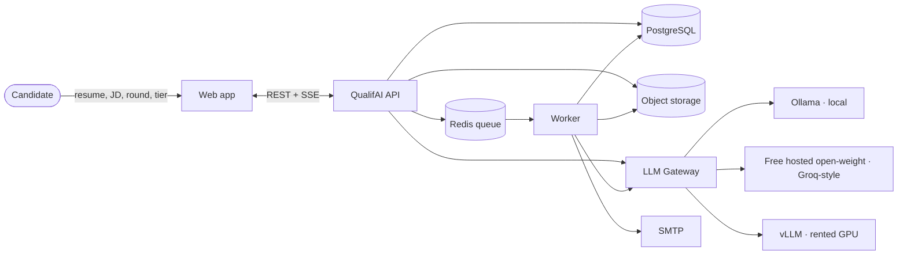
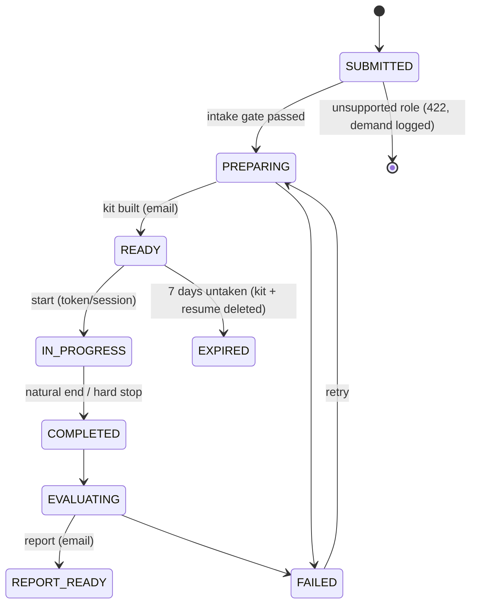
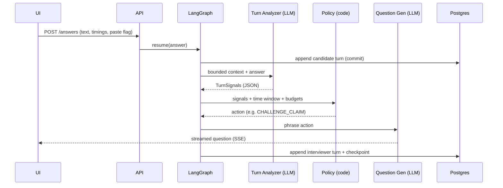
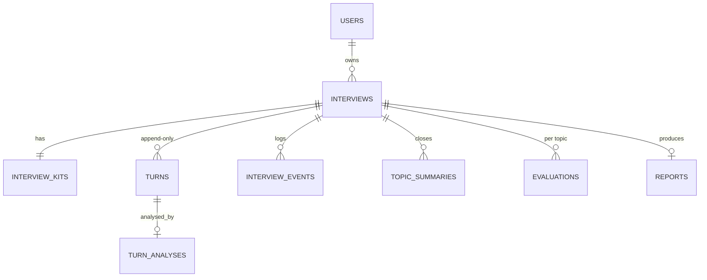

# High-Level Design

## 1. Context

## 2. Components
| Component | Responsibility | Tech |
|---|---|---|
| Web | Thin single-page app: setup, prep status, interview, report; no AI in the browser | React + Vite, static build served by the API |
| API | Validation, auth, intake gate (sync), start/answer endpoints, SSE, serves the built web app | FastAPI |
| Worker | Prep pipeline, evaluation pipeline, hard-stop jobs, daily expiry | arq on Redis |
| Interview engine | LangGraph loop + Policy + Context Compiler + TimeWindow | LangGraph, pure Python |
| LLM Gateway | Task routing, structured output + validation + retries, streaming, telemetry | openai SDK (OpenAI-compatible) |
| Content | Rounds, tiers, role families, skills, problems, model routes | YAML + Pydantic |
| Persistence | Source of truth; checkpoints; JSONB for LLM outputs; pgvector (V2) | PostgreSQL 16 |
| Ephemeral | Drafts, queue, delayed jobs, counters, rate limits | Redis 7 |
| Files | Rendered reports | S3-compatible (MinIO) |
| Sandbox (V2) | Untrusted code execution | Judge0 / Docker + gVisor |

## 3. Lifecycle

## 4. Live turn (sequence)

## 5. Data model (core)

## 6. Non-functional requirements
| NFR | Target (MVP, text mode) |
|---|---|
| Next question latency | p50 < 4 s, p95 < 8 s (two LLM calls; streaming starts earlier) |
| Prep time | ≤ 10 min local, ≤ 3 min hosted; "ready to start" after first 2 topic packs |
| Durability | Submitted answer committed before next question; crash → resume from checkpoint |
| Privacy | Resume deleted after completion/expiry; reports kept 90 days; no answers in logs |
| Cost | ₹0 model cost on free tiers (≈ 1 full interview/day/model on free quotas) |
| Concurrency | 1–3 live interviews per local machine; scale by moving live models to hosted/vLLM |

## 7. Capacity estimate
~30 turns × ~5k tokens (2 calls) ≈ 150k tokens live; prep ≈ 30–40k; eval ≈ 40–60k.
Transcript ≈ 50–150 KB per interview → Postgres is trivially sufficient.

## 8. Failure modes
| Failure | Behaviour |
|---|---|
| LLM timeout / invalid JSON | Gateway retries ×3 with backoff; live loop falls back to a pre-generated opening question; END uses a fixed template |
| Provider rate-limited | Router can switch provider per task via config; prep/eval jobs retry later |
| Redis lost | Rebuild from Postgres checkpoint; lose ≤ a few seconds of draft text |
| Worker crash mid-prep | Job retried; prep steps idempotent on (interview_id, step) |
| Candidate disconnects | Clock continues server-side; rejoin via session; hard-stop job ends it |
| Evidence quotes not found | Dimension dropped; topic may become low-confidence; never invented |

## 9. Security
Candidate/resume text is always data (tagged in prompts; injection markers flagged).
Magic-link tokens stored hashed, swapped for a session cookie at start; one attempt per kit.
Sandbox isolated from API and DB (V2). Secrets only via env; hooks block editing `.env`.
