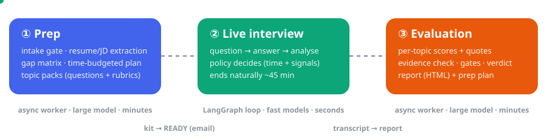
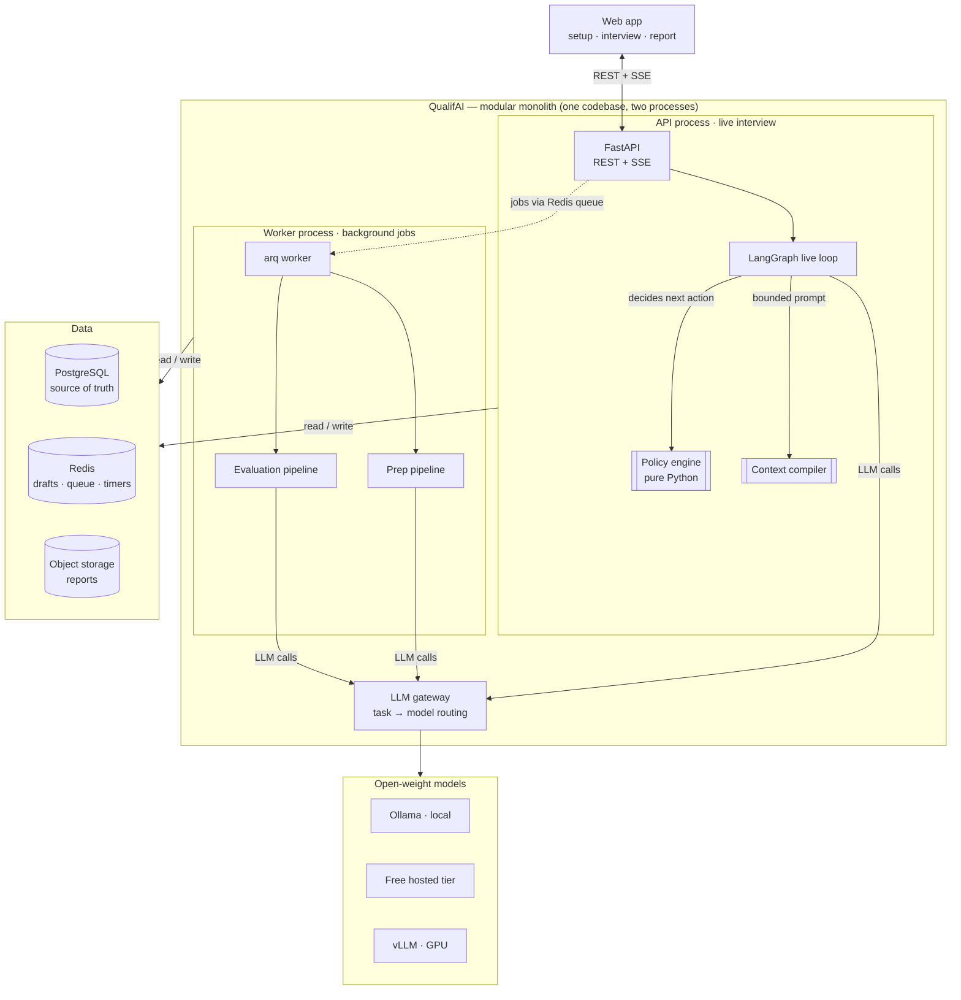
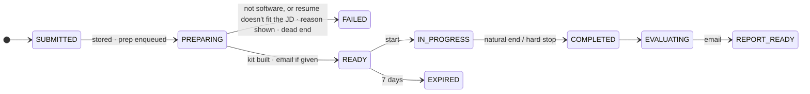
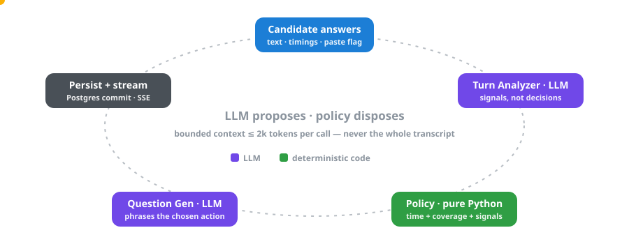
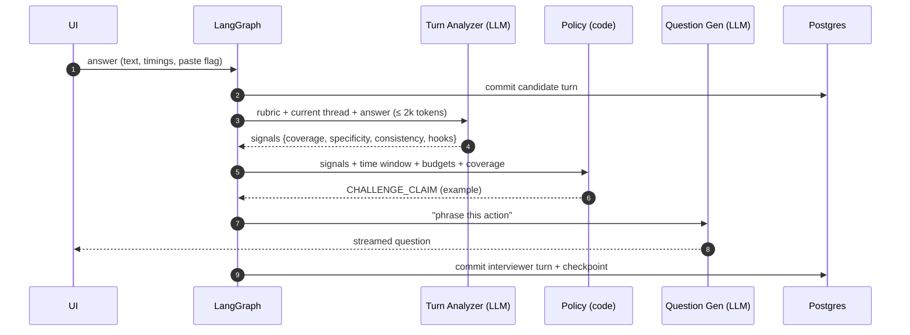
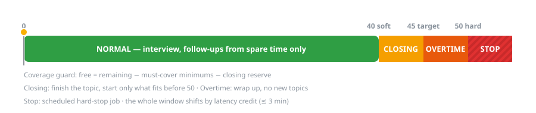
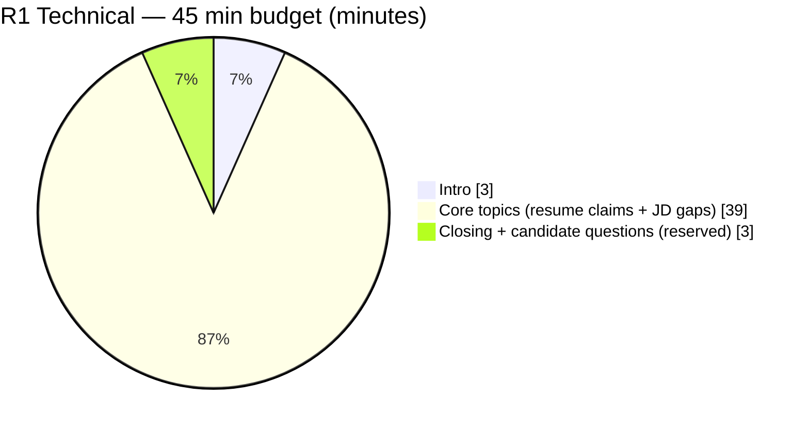
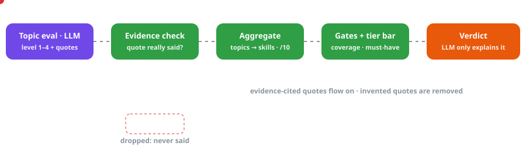
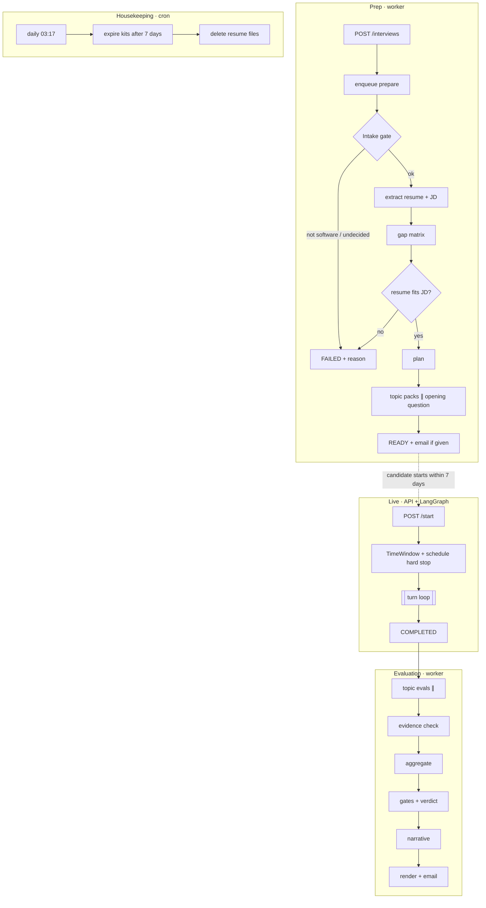
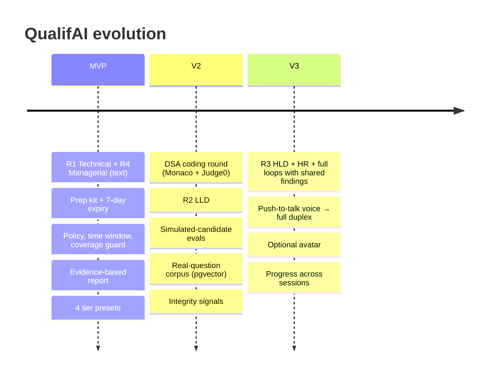

# QualifAI — deep dive

Everything the [README](../README.md) leaves out: design, models, judgement, storage, testing, limits.

---

## Contents
- [Why not just ChatGPT?](#why-not-just-chatgpt)
- [How it works — three phases](#how-it-works--three-phases)
- [Architecture](#architecture)
- [The live turn loop](#the-live-turn-loop)
- [Time management](#time-management)
- [LLMs we use, and where](#llms-we-use-and-where)
- [How judgement works](#how-judgement-works)
- [Workflows](#workflows)
- [Technologies and why](#technologies-and-why)
- [Data storage](#data-storage)
- [Testing](#testing)
- [Limitations](#limitations)
- [Roadmap](#roadmap)
- [Project structure](#project-structure)
- [Getting started](#getting-started)
- [Working with Claude Code](#working-with-claude-code)

---

## Why not just ChatGPT?

| "Upload resume → ask an LLM to interview me" | QualifAI |
|---|---|
| The LLM decides everything, differently each time | A **deterministic policy engine** decides; the LLM proposes signals and phrases questions |
| No sense of time | **Server-owned clock** with a flexible 40/45/50-minute window and per-topic budgets |
| Generic questions | **Claims ledger + gap matrix**: verifies what *you* claimed, tests what the *JD* needs |
| One prompt for every company | **Round template × company tier** (service · startup · product · MAANG) |
| Whole transcript re-sent every turn | **Context compiler**: ≤ 2k tokens per live call, whatever the minute |
| "Good communication, improve depth" | **Every score cites a quote** that is checked against the transcript |
| Opinion as verdict | **Verdict computed by code**, with gates and an honest "insufficient evidence" |

---

## How it works — three phases

<p align="center"></p>

| Phase | What happens | Mode |
|---|---|---|
| **① Prep** | Intake gate (role check) → resume/JD extraction → gap matrix → **match check** (stops only if the resume shows nothing the JD asks for) → time-budgeted plan → topic packs (questions, rubrics, follow-up hooks) + opening question → **READY** (email only if one was given; the candidate checks back with the meet id) | async worker, large model, minutes |
| **② Live interview** | Question → answer → Turn Analyzer → **Policy** (time + signals) → next question; ends naturally around the target time | LangGraph loop, fast models, seconds |
| **③ Evaluation** | Per-topic scores with quotes → evidence check → aggregation → gates → verdict → narrative → HTML report | async worker, large model, minutes |

Inputs: **Resume (text) · JD (text) · Round**, shown as the interview focus (R1 Technical = general, DSA, R2 LLD, R3 HLD, R4 Managerial; HR is API-only) **· Company tier · Experience range · Duration** · optional company name.

> **Not a RAG app.** Resume and JD fit in context. Retrieval appears only as a supporting component
> in V2 (real-question corpus via pgvector). It's best described as an *LLM-orchestrated stateful
> workflow with deterministic control*.

---

## Architecture



**Design principles**
1. **LLM proposes, policy disposes** — routing, time, difficulty, coverage, aggregation and verdict are code.
2. **Bounded context** — no live call ever receives the whole transcript.
3. **Evidence or no score.**
4. **Content is config** — rounds, tiers, role families, skills, problems and model routes are YAML.
5. **Modular monolith** — split processes only where isolation is needed (API, worker, model server, sandbox).

Full design: [`docs/architecture/hld.md`](architecture/hld.md) · decisions: [`ADRs`](architecture/adr/README.md)

### Interview lifecycle


---

## The live turn loop

<p align="center"></p>



**Policy actions:** `FOLLOW_UP_DEEPER` · `CLARIFY_MISSING` · `PROBE_SPECIFICITY` · `CHALLENGE_CLAIM` ·
`SCAFFOLD` · `REPHRASE_QUESTION` · `REDIRECT_BACK` · `NEXT_TOPIC` · `CLOSE_TOPIC_TIME` · `WRAP_UP` · `END`

Example: the resume says *"Designed microservices using Kubernetes"*, the JD weights Kubernetes highly →
the gap matrix marks it **verify claim** → *"Walk me through the architecture."* → a fluent but vague answer →
`specificity = low` → **PROBE_SPECIFICITY**: *"What exactly did you configure yourself?"* → the answer reveals another team owned it →
`consistency = inflated` → **CHALLENGE_CLAIM**.

---

## Time management

<p align="center"></p>

- The **server owns the clock** (`started_at`, `soft_start`, `target_end`, `hard_end`); the UI shows `32:10 / ~45 min`.
- **Plan = prioritised pool** (must / should / bonus), not a checklist; not every question gets asked.
- **Coverage guard:** `free = remaining − must-cover minimums − closing reserve`; follow-ups can only use `free`.
- **Topic budgets + max depth** (from the tier) stop one cross-question from taking over the interview.
- **Latency credit:** slow model time shifts the window (≤ 3 min), so candidates aren't penalised for hardware.
- **Hard stop** is a scheduled job; the closing message is a fixed template, so it works even if the LLM is down.
- The LLM never "knows" the time: the policy decides, and the generator is only told *"this is the final question"*.



---

## LLMs we use, and where

All models are **open-weight**, called through **one OpenAI-compatible gateway**. The task → model mapping
lives in [`content/models.yaml`](../content/models.yaml), so models change through config, not code.

| Phase | Task | Size tier | Default model* | Why this tier |
|---|---|---|---|---|
| Prep | Intake gate (is-resume, is-JD, role family of each) | Small | Gemma 4 (small, local via Ollama) | Classification, cheap, first step of the prep job |
| Prep | Resume → claims ledger | Large | gpt-oss-120b (hosted free tier) | Extraction quality drives everything downstream |
| Prep | JD → weighted skills | Large | gpt-oss-120b | Same |
| Prep | Topic packs (questions, rubric, hooks) | Large | gpt-oss-120b | **Biggest quality lever**: good rubrics make small live models judge well |
| Prep | Opening question | Large | gpt-oss-120b | The first thing the candidate reads; written once, from their lead claims and the JD's must topics |
| Live | Turn Analyzer (signals) | Medium | gpt-oss-20b | Judgement on narrow criteria, needs speed |
| Live | Question Generator (phrasing) | Small | Gemma 4 (local) | Only phrasing a decided action |
| Live (V2) | Coding helper | Medium | gpt-oss-20b | Clarifications, hints within limits |
| Eval | Per-topic evaluation | Large | Qwen 3.x 27B | Careful, evidence-cited scoring; latency irrelevant |
| Eval | Code review | Large / coder | Qwen2.5-Coder 14B | Code quality + complexity explanation |
| Eval | Cross-topic contradiction check | Medium | gpt-oss-20b | Over topic summaries only |
| Eval | Report narrative | Medium | gpt-oss-20b | Explains computed numbers; never changes them |

<sub>*Defaults as of Oct 2026. Free hosted tiers rotate models and cap quotas **per model**, so phases are deliberately spread across different models. A full interview uses roughly 30–40k (prep) + ~150k (live) + 40–60k (eval) tokens.</sub>

**Not LLM:** gap matrix, planner, time window, coverage guard, policy, topic selection, evidence check, aggregation, gates, verdict, HTML rendering, code execution, test grading.

---

## How judgement works

<p align="center"></p>

1. **Per topic, not per question or per interview.** A topic is a thread (opening question + follow-ups). Follow-ups depend on each other, and whole-interview prompts are too long for small models.
2. **Anchored levels**, not 1–10:

   | Level | Meaning | Shown as |
   |---|---|---|
   | 1 | Incorrect / no real understanding | 2.5 / 10 |
   | 2 | Basic, textbook, misses key points | 5.0 / 10 |
   | 3 | Solid, covers most expected points | 7.5 / 10 |
   | 4 | Strong: depth, trade-offs, real experience | 10 / 10 |

3. **Evidence check (code):** every level must cite a quote; quotes are matched (exact → normalised → fuzzy ≥ 0.85) against the candidate's turns. Unmatched → the dimension is dropped.
4. **Aggregation (code):** topic → skill, weighted by questions asked; confidence = how much evidence exists. **Not asked = not assessed, never zero.**
5. **Overall** = Σ(skill × JD weight) / Σ(JD weight) over assessed skills.
6. **Gates** can only lower or withhold a verdict:

   | Gate | Rule |
   |---|---|
   | Coverage | Must-cover topics opened < 75% → **Insufficient evidence** |
   | Must-have | Any must-have skill below the tier floor → max **Lean Hire** |
   | Claim | A contradicted resume claim → max **Lean Hire** |
   | Coding (V2) | < 50% hidden tests → max **Hire** |
   | Integrity | Paste/timing flags → warning shown, verdict unchanged |

7. **Tier thresholds** (from `content/tiers/*.yaml`):

   | Band | Service | Startup | Product | MAANG |
   |---|---|---|---|---|
   | Strong Hire | ≥ 8.0 | ≥ 8.2 | ≥ 8.5 | ≥ 8.8 |
   | Hire | ≥ 6.5 | ≥ 7.0 | ≥ 7.5 | ≥ 8.0 |
   | Lean Hire | ≥ 5.5 | ≥ 6.0 | ≥ 6.5 | ≥ 7.0 |
   | Lean No Hire | ≥ 4.5 | ≥ 5.0 | ≥ 5.5 | ≥ 6.0 |

8. **The LLM explains, never decides.** The narrative receives the computed JSON and must not change any number.

<details>
<summary><b>Worked example (this exact case is a unit test)</b></summary>

| Skill | Score | JD weight | Must-have |
|---|---|---|---|
| Kubernetes | 8.1 | 3 | ✓ |
| PostgreSQL | 4.6 | 3 | ✓ |
| FastAPI | 7.5 | 2 | |
| Coding | 6.0 | 2 | |
| Behavioral | 7.0 | 1 | |

Overall = (24.3 + 13.8 + 15 + 12 + 7) / 11 = **6.55**

- **Service tier:** 6.55 → Hire, but PostgreSQL < 5.0 → must-have gate → **Lean Hire ("Almost ready")**
- **Product tier:** 6.55 → **Lean Hire** (gate has no further effect)
- **MAANG tier:** 6.55 → **Lean No Hire ("Needs preparation")**

Deciding gap reported to the candidate: *PostgreSQL indexing and isolation levels.*
</details>

**Coding (V2):** correctness and efficiency come from **tests** (hidden + performance tests with time limits). The LLM labels Big-O and explains it; if it disagrees with the tests, the tests win.

---

## Workflows



| Workflow | Sync / async | Engine |
|---|---|---|
| Intake gate | async, first step of prep (fails before any large-model cost) | arq job |
| Prep | async | arq job, plain async code |
| Live interview | sync per turn, streamed | LangGraph + Postgres checkpointer |
| Hard stop | delayed job at `hard_end + 60 s` | arq |
| Evaluation | async | arq job, plain async code |
| Expiry / retention | daily cron | arq |

---

## Technologies and why

| Concern | Choice | Why (and what we rejected) |
|---|---|---|
| API | **FastAPI** + Pydantic v2 | Async, typed, SSE-friendly; Pydantic schemas double as LLM output contracts |
| Live loop | **LangGraph** (only here) | Cyclic state machine + `interrupt()` for human input + Postgres checkpointer for crash recovery. Prep/eval are DAGs → plain async |
| LLM access | **OpenAI-compatible client** via a gateway | One client for Ollama, free hosted tiers and vLLM; task routing in YAML |
| Models | **Open-weight** (gpt-oss, Qwen, Gemma) | ₹0 to run; swappable; no proprietary lock-in |
| Local inference | **Ollama** (dev), **vLLM** (GPU) | Simple locally; vLLM for parallel, batched serving |
| Background jobs | **arq** on Redis | Async-native, delayed jobs + cron built in; no extra broker |
| Database | **PostgreSQL 16** (+ pgvector in V2) | Relational data, transactions, JSONB for LLM outputs, LangGraph checkpoints, vectors without another DB |
| Ephemeral | **Redis 7** | Drafts every few seconds, queue, timers, rate limits; loss costs seconds |
| Files | **MinIO / S3** | Binary files out of the DB; simple retention deletes |
| Reports | **Jinja2** (+ optional WeasyPrint PDF) | Same layout every time; never LLM-written HTML |
| Sandbox (V2) | **Judge0** self-hosted; gVisor/Firecracker later | Untrusted code isolated from API and DB |
| Frontend | **React + Vite** (TypeScript, Tailwind); Monaco in V2 | Thin client, no AI in the browser; builds to static files the API serves, so no extra server ([ADR-0015](architecture/adr/0015-react-vite-spa-served-by-api.md)) |
| Quality | ruff · mypy strict · import-linter · pytest · Hypothesis · testcontainers | Architecture rules enforced by tooling, not reviews |
| **Not used** | MCP · microservices · Kafka · MongoDB · separate vector DB | No real need yet — see [ADR-0001](architecture/adr/0001-modular-monolith.md), [ADR-0010](architecture/adr/0010-no-mcp.md) |

---

## Data storage

| Store | Holds | Why |
|---|---|---|
| **PostgreSQL** | users, interviews (+ resume text until completion/expiry, time window, end reason), kits (JSONB), **append-only `turns`**, turn analyses, events (paste/idle), topic summaries, evaluations, reports (JSON), checkpoints, demand log | Source of truth; an answer is committed before the next question is shown |
| **Redis** | answer drafts, job queue, delayed hard-stop jobs, live counters, rate limits | Fast and disposable |
| **Object storage** | rendered report HTML/PDF | Deleted by retention jobs |

Privacy: resume deleted after completion/expiry · reports kept 90 days · answers never written to logs.

---

## Testing

| Level | What it proves | Runs |
|---|---|---|
| 🧪 Unit | Policy table, time zones, coverage guard, gap matrix, planner, evidence matching, aggregation, gates, verdict (+ Hypothesis properties) | every push |
| 🏛️ Architecture | Deterministic core never imports LLM/DB/LangGraph; only `qualifai.llm` imports provider SDKs | every push + hook |
| 📜 Contract | Recorded LLM outputs validate; off-scale or invented-decision outputs rejected | every push |
| 🗄️ Integration | Postgres schema, constraints, repositories (testcontainers) | every PR |
| 🔁 E2E | Real LangGraph loop + FakeLLM + FrozenClock: natural end, hard stop, depth bounds | every PR |
| 🔐 Security | Role refusal, injection rules in prompts, Claude hooks block secrets/destructive commands | every PR |
| ⚡ Load | p95 next-question latency < 8 s | before demos |
| 🧠 Evals | Simulated candidates: strong > weak, bluffer caught ≥ 80%, score stability | on model/prompt change |

Details: [`tests/README.md`](../tests/README.md). Current scaffold: **125 tests passing**, ruff + mypy strict + import-linter clean.

---

## Limitations

- **Small-model judgement** is the main risk. Mitigated (large-model rubrics, seed anchors, evidence check, evals), not eliminated.
- **No ground truth** for scores until the eval harness and human-labelled answers exist; treat reports as practice feedback, not hiring decisions.
- **Free-tier quotas** allow roughly one full interview per model per day; heavier use needs local models or a rented GPU.
- **Voice**: the interviewer speaks through a local speech model, Kokoro-82M (ADR-0024), and falls back to the browser's voice when it is not running. Listening is the browser's (ADR-0022): Firefox cannot listen and falls back to typing, speech recognition can mishear technical terms and a spoken answer is sent as heard, and a long pause mid-answer ends it. In the typing fallback, pasting stays possible (recorded as integrity flags, not blocked).
- **Backend SDE only** in MVP; nearby technical roles run in limited mode; non-technical roles are declined.
- **Content-bound quality:** skills without a seed bank are generated "unanchored" and marked lower-confidence.
- **Local hardware:** a laptop handles roughly one live interview at a time; fanless machines throttle.
- **Company specifics** are approximated by tier; per-company formats are optional flavour only.

---

## Roadmap



---

## Project structure

```text
qualifai/
├── CLAUDE.md                      # rules for AI-assisted development
├── .claude/
│   ├── settings.json              # hooks + permissions
│   ├── hooks/                     # protect files, guard bash, README-before-commit, architecture guard, format, fast tests
│   ├── skills/                    # implement-spec-task, add-round-template, add-skill-seed-bank, ...
│   └── agents/                    # architecture-reviewer
├── docs/
│   ├── architecture/              # overview.md, hld.md, adr/0001..0013
│   ├── specs/                     # 001 MVP (spec → plan → tasks), 002, 003 drafts
│   └── assets/                    # animated SVGs
├── content/                       # rounds/ tiers/ role_families/ skills/ coding_problems/ models.yaml
├── src/qualifai/
│   ├── domain/                    # enums, models, lifecycle, clock — pure
│   ├── prep/                      # intake gate, extraction, gap matrix, planner, topic packs, pipeline
│   ├── interview/                 # time_window, policy, coverage, context_compiler, graph, service
│   ├── eval/                      # topic eval, evidence check, aggregation, verdict, narrative, render
│   ├── llm/                       # gateway, router, tasks, prompts/*.md, FakeLLM
│   ├── content/  db/  api/  workers/  notifications/  storage/  coding/ (V2)
├── tests/                         # unit architecture contract integration e2e security evals load
├── migrations/  docker/  frontend/  scripts/
└── docker-compose.yml  Makefile  pyproject.toml
```

---

## Getting started

```bash
cp .env.example .env              # add a free hosted-tier key, or use local Ollama only
make install                      # uv sync
make up                           # postgres, redis, minio, mailpit
make up-llm                       # optional: local Ollama
make migrate && make seed         # schema + validate content
make test                         # fast lane: unit + architecture + contract
make api                          # http://localhost:8000/docs
make worker                       # prep / evaluation / cleanup jobs
make web                          # web app with hot reload: http://localhost:3000
```

Or start everything with one command: `./start.sh` brings up the Docker services, applies
migrations, and runs the API, worker and web app together (Ctrl+C stops them).

`make web-build` compiles the web app into `frontend/dist`; the API then serves it itself at
http://localhost:8000 (set `QUALIFAI_BASE_URL` to that address so emailed links point there).

The web form asks for no email (ADR-0017). A submission sent to the API with an `email` still
gets the ready mail, which lands in Mailpit at http://localhost:8025.

---

## Working with Claude Code

This repo is set up for spec-driven, AI-assisted development:

- **`CLAUDE.md`** holds the golden rules every session follows.
- **Hooks** stop edits to secrets, destructive commands, and LLM imports in the deterministic core; require a README update before each commit; format edited files; and run fast tests before a session ends.
- **Skills**: `implement-spec-task`, `add-round-template`, `add-skill-seed-bank`, `add-coding-problem`, `add-llm-task`, `write-adr`.
- **Specs**: pick a `T-nn` from [`docs/specs/001-mvp-r1-technical/tasks.md`](specs/001-mvp-r1-technical/tasks.md); code TODOs reference the same IDs.

---

<sub>MIT © 2026 Shubham Kumar Gupta · Built as a portfolio project. QualifAI is a practice tool, not a hiring decision system.</sub>
