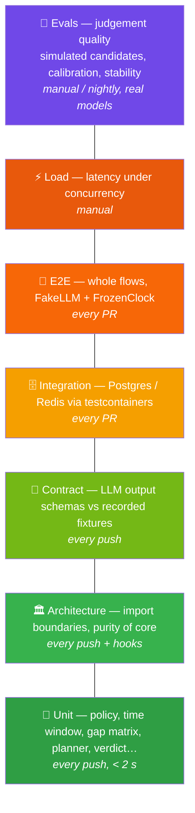

# Testing strategy

QualifAI mixes deterministic code with probabilistic models, so it needs **two kinds of
testing**: classic correctness tests for code, and *quality evals* for model judgement.



| Level | Folder | Marker | What it proves | Needs | When |
|---|---|---|---|---|---|
| Unit | `unit/` | `unit` | Deterministic logic is correct: policy table, time zones, coverage guard, gap matrix, planner budgets, evidence matching, aggregation, gates, verdict (incl. spec AC-2, AC-5); Hypothesis properties (window markers ordered, gates never raise a band) | nothing | every push, Stop hook |
| Architecture | `architecture/` | `architecture` | Pure core never imports LLM/DB/LangGraph; only `qualifai.llm` imports provider SDKs; API has no LLM calls | nothing | every push, PostToolUse hook |
| Contract | `contract/` | `contract` | Recorded model outputs validate; off-scale / extra-field / invented-decision outputs are rejected | nothing | every push; re-record on prompt/model change |
| Integration | `integration/` | `integration` | Schema, constraints (append-only turn uniqueness), repositories, checkpointer | Docker | every PR |
| E2E | `e2e/` | `e2e` | Real LangGraph loop with in-memory checkpointer: natural end, hard stop, depth bounds, policy-chosen actions | nothing (HTTP-level e2e needs Docker, T-27) | every PR |
| Security | `security/` | `security` | Unsupported roles/invalid docs refused; prompts carry injection rules; Claude hooks block secrets, destructive commands and architecture violations; (V2) sandbox escape smoke tests | nothing | every PR |
| Load | `load/` | — | Next-question p95 < 8 s under concurrent interviews (NFR-1) | running stack | before demos |
| Evals | `evals/` | `evals` | Judgement quality: strong > weak, bluffer caught ≥ 80%, score stability ≤ 1 level spread | a model | manual / nightly, on model or prompt change |

## Commands
```bash
make test              # unit + architecture + contract (fast lane)
make test-integration  # Docker
make test-e2e
make evals             # needs QUALIFAI_* model config
```

## Conventions
- Time-dependent code takes `now`/`Clock` as input → use `FrozenClock`; never `sleep`.
- LLM-dependent code takes the `LLM` protocol → use `FakeLLM` with deterministic responders.
- Every spec acceptance criterion gets a test named after it (`test_ac2_...`).
- Coverage gate: 80% branch coverage on `src/qualifai` (CI).
